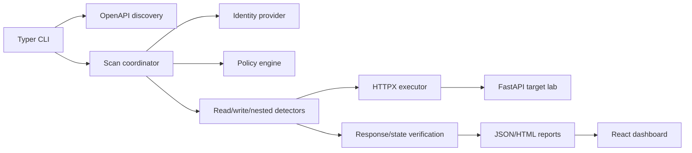

# Architecture

The project is a modular monolith with a deliberately vulnerable local FastAPI
target and a Python scanner. The scanner separates discovery, identity
management, ownership/policy intelligence, detectors, verification, and
reporting.

The lab currently uses deterministic in-memory fixtures so security regression
tests are repeatable. PostgreSQL is included in Compose as the planned
persistence boundary; it is not silently used by the current scanner.
